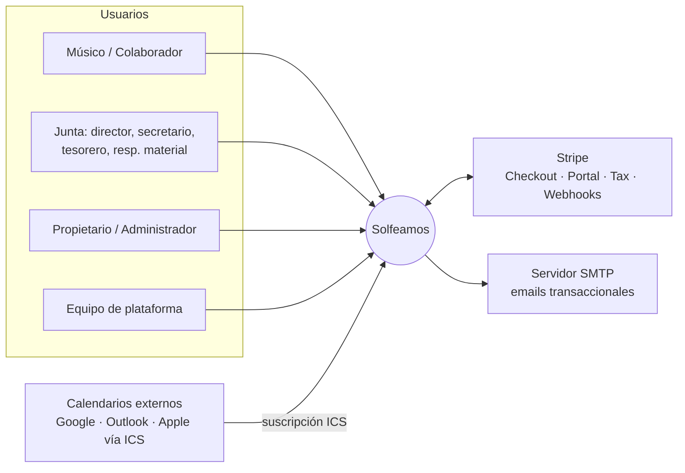
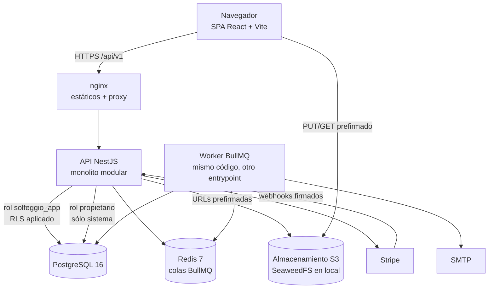
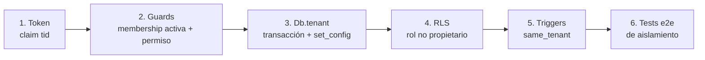
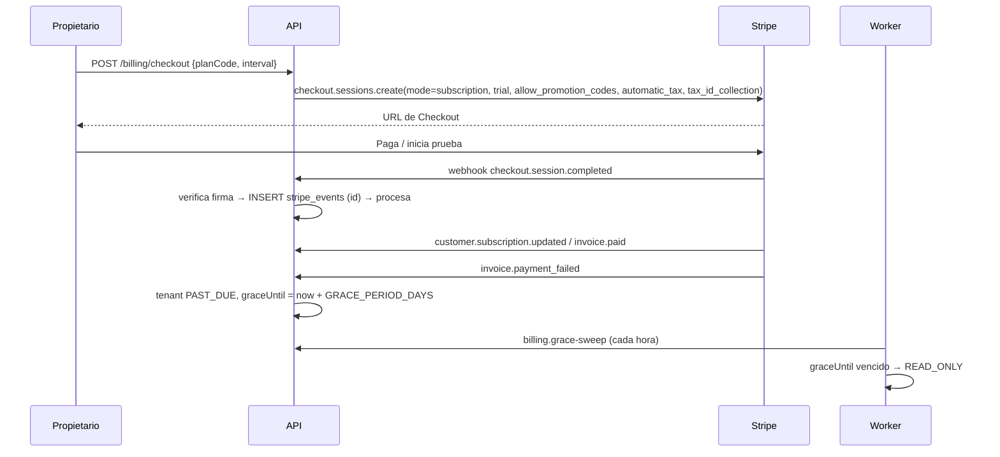

# Arquitectura de Solfeamos

Solfeamos es una plataforma SaaS multi-tenant para gestionar bandas de música. Cada banda registrada es un **tenant** independiente. Todas las bandas comparten base de datos y esquema, y el aislamiento entre ellas se garantiza con la columna `tenant_id` y con Row Level Security (RLS) de PostgreSQL.

## 1. Contexto (C4 nivel 1)

## 2. Contenedores (C4 nivel 2)

| Contenedor | Tecnología | Responsabilidad |
|---|---|---|
| `web` | React 18 + Vite, servido por nginx | Interfaz responsive y accesible basada en tarjetas |
| `api` | NestJS 10 + Prisma 5 (Node 22) | API REST versionada (`/api/v1`), autorización y reglas de negocio |
| `worker` | NestJS (`dist/worker.js`) + BullMQ | Tareas asíncronas y programadas |
| `postgres` | PostgreSQL 16 | Datos relacionales, RLS, búsqueda de texto completo (`spanish` + `unaccent`) |
| `redis` | Redis 7 | Colas BullMQ, reintentos y deduplicación de recordatorios |
| `s3` (SeaweedFS en local) / S3 | API compatible con S3 | Partituras, audios, documentos e imágenes de anuncios |
| `mailpit` | Sólo en desarrollo | Captura de los emails enviados |

## 3. Monolito modular

La API es un **monolito modular**: un único despliegue con módulos NestJS cohesivos que sólo se comunican a través de sus servicios públicos. Las tablas de un módulo sólo las toca ese módulo. Así, si en el futuro hiciera falta, un módulo se podría extraer como servicio independiente.

| Módulo | Contenido |
|---|---|
| `auth` | Registro, login, MFA TOTP, rotación de refresh tokens, cambio de tenant, aceptación de invitaciones |
| `tenancy` | Onboarding, ajustes del tenant, límites del plan (`LimitsService`), panel de inicio (dashboard) |
| `db` | `Db.tenant(tenantId, tx => …)` (contexto RLS) y `Db.system` (rol propietario) |
| `iam` | Roles, catálogo de permisos, usuarios del tenant (memberships), invitaciones |
| `audit` | `Audit.log(tx, …)`, dentro de la misma transacción que el cambio auditado |
| `members` | Secretaría: socios, altas y bajas, secciones, tallas, documentos, comunicaciones, exportación y anonimización RGPD |
| `archive` | Compositores, obras, versiones, archivos (partituras, particellas, audio), etiquetas y búsqueda |
| `events` | Ensayos, actuaciones y reuniones; repertorio; convocatorias y respuestas |
| `attendance` | Registro de asistencia, justificaciones con revisión, estadísticas |
| `treasury` | Categorías, movimientos, cuotas, emisión de recibos, cobros, informes y exportación CSV |
| `wardrobe` | Mayordomía: prendas, tallas, entregas y devoluciones |
| `instruments` | Inventario, asignaciones, mantenimiento y reparaciones |
| `agenda` | Calendario unificado (eventos, vencimientos de cuotas y préstamos) y feed ICS |
| `notifications` | Notificaciones dentro de la app y encolado de emails |
| `market` | BandMarket: anuncios, moderación, consultas entre bandas, denuncias |
| `billing` | Planes, Stripe Checkout, Customer Portal, webhooks, facturas, periodo de gracia |
| `admin` | Panel global: tenants, planes, incidencias, moderación, métricas |
| `storage` | Wrapper de S3: claves por tenant, URLs prefirmadas, control de cuota |
| `health` | `/health`, `/health/ready`, `/metrics` (Prometheus) |

El **worker** (`dist/worker.js`) arranca la base de datos, la cola y los procesadores, sin servidor HTTP. Usa una única cola BullMQ llamada `solfeggio`, con 5 reintentos y backoff exponencial por defecto:

| Trabajo | Disparo | Qué hace |
|---|---|---|
| `email.send` | Encolado por servicios | Envía el email por SMTP con nodemailer |
| `notify.fanout` | Comunicación, convocatoria, cancelación, facturación, moderación… | Resuelve socios → usuarios, crea una notificación in-app por usuario y, si procede, encola un `email.send` por destinatario |
| `events.reminders` | Cron `*/15 * * * *` | Recordatorios según `Event.reminderMinutes` (por defecto, 24 h antes) a los convocados que no han rechazado |
| `billing.grace-sweep` | Cron `5 * * * *` (cada hora) | Pasa a `READ_ONLY` los tenants `PAST_DUE` cuyo `graceUntil` ya ha vencido |
| `finance.overdue` | Cron `30 3 * * *` | Marca como `OVERDUE` los recibos `PENDING` cuya fecha de vencimiento ya ha pasado |
| `storage.recount` | Cron `0 4 * * *` | Recalcula `Tenant.storageUsedBytes` a partir de `assets` y `documents` |

Los crons usan la zona `Europe/Madrid` y un `jobId` fijo (`cron:<nombre>`), así que varias réplicas del worker no duplican la planificación. Los recordatorios se deduplican con una clave Redis `reminder:{eventId}:{minutes}` creada con `SET NX` (caduca a los 30 días), de modo que cada aviso se envía una sola vez.

## 4. Aislamiento multi-tenant

El aislamiento se construye en **capas** independientes, de modo que el fallo de una no basta para filtrar datos de otro tenant.

1. **Tenant en el token, nunca en la URL.** El access token JWT lleva `sub` (usuario) y `tid` (tenant activo). El tenant activo se elige con `POST /auth/switch-tenant`, que comprueba que exista una `Membership` activa. Ninguna ruta acepta `tenantId` por parámetro, por cuerpo ni por cabecera.
2. **Guard global.** `AuthGuard` (`apps/api/src/auth/auth.guard.ts`) valida el JWT y vuelve a cargar la membership, el rol y el plan en cada petición, lo que permite revocar el acceso al instante. En el mismo paso evalúa `@Perm(...)`, `@RequireFeature(...)`, `@PlatformAdmin()` y el modo sólo lectura del tenant.
3. **`Db.tenant`.** Todo acceso a datos de negocio pasa por `db.tenant(tenantId, tx => …)` (`apps/api/src/db/db.service.ts`). El método abre una transacción interactiva de Prisma con el rol de aplicación y ejecuta primero `SELECT set_config('app.tenant_id', $tid, true)`. Al pasar `true`, el valor vive sólo dentro de esa transacción, así que no se filtra a otras peticiones a través del pool de conexiones. Antes de escribir, los servicios cargan bajo RLS las entidades referenciadas, de modo que un id ajeno da 404.
4. **RLS en PostgreSQL.** La API conecta con el rol `solfeggio_app`, que no es propietario de las tablas ni tiene `BYPASSRLS`, de modo que las políticas se aplican siempre. La política estándar es `tenant_id = app_current_tenant()`, tanto en `USING` como en `WITH CHECK`. Sin contexto, `app_current_tenant()` devuelve `NULL` y la consulta devuelve 0 filas (diseño *fail-closed*).
5. **Cliente de sistema.** `Db.system` es un segundo `PrismaClient` conectado con el rol propietario (`SYSTEM_DATABASE_URL`). Como el propietario no está sujeto a RLS (no se usa `FORCE`), este cliente se reserva por convención a los webhooks de Stripe, al worker, al panel global, a la autenticación (login, memberships, tokens) y a lecturas acotadas como los nombres públicos de las bandas vendedoras de BandMarket.
6. **Permisos por columna.** El rol `solfeggio_app` sólo puede actualizar `name`, `legalName`, `taxId`, `country`, `timezone` y `locale` de `tenants`; no puede escribir en `plans`, `users`, `subscriptions` ni `invoices`; `audit_logs` es *append-only* (sin `UPDATE` ni `DELETE`); y no tiene acceso a `stripe_events`, `refresh_tokens` ni `_prisma_migrations`.
7. **Triggers `same_tenant`.** Las claves foráneas de PostgreSQL no tienen en cuenta RLS. Por eso `app_enforce_same_tenant()` comprueba en cada `INSERT`/`UPDATE` que las filas referenciadas (`memberId`, `eventId`, `workId`…) pertenezcan al mismo `tenant_id`, y si no es así lanza `23503`.
8. **404, no 403.** Un identificador que pertenece a otro tenant se comporta exactamente igual que uno inexistente, para no revelar que existe.
9. **Pruebas.** `apps/api/test/tenant-isolation.e2e-spec.ts` (44 tests) crea dos bandas y comprueba lectura, escritura, borrado, referencias cruzadas, claves de archivo, listados, búsqueda, auditoría, cambio de tenant, BandMarket, feed ICS, RLS directo con el rol de aplicación, permisos por columna y cifrado de datos sensibles.

Datos que cruzan tenants **a propósito**:

- Los anuncios de BandMarket en estado `PUBLISHED` son visibles para todas las bandas. Las políticas específicas de `listings`, `listing_inquiries` y `listing_reports` se detallan en [data-model.md](data-model.md).
- El catálogo de planes (`plans`).
- Los usuarios (`users`) son globales, porque una misma persona puede pertenecer a varias bandas.

## 5. RBAC por tenant

- `Role` pertenece a un tenant y tiene un `key`, un nombre y un array `permissions` con claves del catálogo de [api.md](api.md#catálogo-de-permisos).
- Cada `Membership` (usuario dentro de un tenant) tiene exactamente un rol.
- Al crear un tenant se generan 8 roles de sistema (`isSystem = true`). Sus permisos se pueden editar, pero los roles no se pueden borrar. Además, cada banda puede crear roles personalizados.
- El rol `owner` siempre conserva todos los permisos y no se puede quitar al último propietario.

Permisos por defecto, tal como se definen en `SYSTEM_ROLES` (`apps/api/src/iam/permissions.ts`) (✔ = concedido):

| Permiso | owner | admin | director | secretary | treasurer | material_manager | musician | collaborator |
|---|:-:|:-:|:-:|:-:|:-:|:-:|:-:|:-:|
| tenant:manage | ✔ | ✔ |  |  |  |  |  |  |
| billing:manage | ✔ |  |  |  |  |  |  |  |
| users:manage | ✔ | ✔ |  |  |  |  |  |  |
| roles:manage | ✔ | ✔ |  |  |  |  |  |  |
| audit:read | ✔ | ✔ |  | ✔ |  |  |  |  |
| members:read | ✔ | ✔ | ✔ | ✔ | ✔ | ✔ |  |  |
| members:write | ✔ | ✔ |  | ✔ |  |  |  |  |
| members:sensitive | ✔ | ✔ |  | ✔ | ✔ |  |  |  |
| communications:send | ✔ | ✔ | ✔ | ✔ |  |  |  |  |
| documents:read | ✔ | ✔ | ✔ | ✔ | ✔ |  |  |  |
| documents:write | ✔ | ✔ |  | ✔ |  |  |  |  |
| archive:read | ✔ | ✔ | ✔ | ✔ | ✔ | ✔ | ✔ | ✔ |
| archive:write | ✔ | ✔ | ✔ |  |  |  |  |  |
| events:read | ✔ | ✔ | ✔ | ✔ | ✔ | ✔ | ✔ | ✔ |
| events:write | ✔ | ✔ | ✔ |  |  |  |  |  |
| calls:manage | ✔ | ✔ | ✔ |  |  |  |  |  |
| attendance:read | ✔ | ✔ | ✔ | ✔ |  |  |  |  |
| attendance:write | ✔ | ✔ | ✔ |  |  |  |  |  |
| attendance:self | ✔ | ✔ | ✔ | ✔ | ✔ | ✔ | ✔ |  |
| finance:read | ✔ | ✔ |  |  | ✔ |  |  |  |
| finance:write | ✔ | ✔ |  |  | ✔ |  |  |  |
| wardrobe:read | ✔ | ✔ | ✔ |  |  | ✔ |  |  |
| wardrobe:write | ✔ | ✔ |  |  |  | ✔ |  |  |
| instruments:read | ✔ | ✔ | ✔ |  |  | ✔ |  |  |
| instruments:write | ✔ | ✔ |  |  |  | ✔ |  |  |
| market:read | ✔ | ✔ | ✔ |  |  | ✔ | ✔ |  |
| market:write | ✔ | ✔ |  |  |  | ✔ |  |  |
| incidents:write | ✔ | ✔ | ✔ | ✔ | ✔ | ✔ |  |  |

Los cambios de rol, de permisos y de membership se registran en `audit_logs`.

## 6. Planes, límites y funcionalidades

- `Plan` define `maxUsers`, `maxMembers`, `maxStudents`, `storageMb` y `features[]`. Para Enterprise, `-1` significa ilimitado. Los valores están en `apps/api/prisma/plans.ts`, se resumen en [api.md](api.md#funcionalidades-por-plan) y se cargan con el seed.
- Un tenant puede tener **add-ons** (`tenants.addons`), funcionalidades contratadas aparte del plan que gestiona el panel global; las funcionalidades efectivas son la unión del plan y los add-ons. El add-on Escuela suma además plazas de alumno (`tenants.studentSeats`) a las del plan.
- `@RequireFeature('treasury')` devuelve **403 `FEATURE_NOT_IN_PLAN`** si el plan del tenant no incluye esa funcionalidad.
- Los límites de socios y usuarios (contando invitaciones pendientes) se comprueban al crear socios, reactivarlos o invitar. El almacenamiento se reserva de forma atómica al **confirmar** una subida, con el tamaño real del objeto. Si se superan, la API responde **403 `PLAN_LIMIT`**.
- Cuando un tenant está en `READ_ONLY`, `AuthGuard` rechaza toda petición `POST`, `PUT`, `PATCH` o `DELETE` con **403 `TENANT_READ_ONLY`**, salvo las rutas marcadas con `@AllowReadOnly()` (checkout y portal de facturación), para que la banda pueda regularizar el pago. Un tenant `SUSPENDED` pierde el acceso por completo (**401 `TENANT_ACCESS_REVOKED`**).
- Al bajar de plan no se borran datos: si el uso supera los nuevos límites, sólo se bloquean las nuevas altas.

## 7. Facturación con Stripe

- **SDK:** `stripe` 17 fijado a la API `2025-02-24.acacia` (`apps/api/src/billing/stripe.provider.ts`). Sin `STRIPE_SECRET_KEY`, las rutas de facturación responden **503 `BILLING_NOT_CONFIGURED`**.
- **Checkout:** `mode: subscription`, con el price mensual o anual del plan, `subscription_data.trial_period_days` (los `trialDays` del plan o `TRIAL_DAYS`, 14) **sólo si la banda nunca ha tenido suscripción ni facturas**, `allow_promotion_codes: true` para los cupones creados en Stripe, `automatic_tax` (Stripe Tax, IVA; `STRIPE_TAX_ENABLED`), `tax_id_collection` para el CIF de la asociación y `billing_address_collection: required`. El `client_reference_id` y los metadatos llevan el id del tenant. Al terminar, Stripe vuelve a `/billing?checkout=success` o `/billing?checkout=cancel`. Una clave de idempotencia por minuto evita sesiones duplicadas por doble clic.
- **Customer Portal:** el cliente cambia de plan o de intervalo, actualiza el método de pago, cancela al final del periodo y descarga facturas. Los cambios llegan por webhook.
- **Webhooks** (`POST /api/v1/webhooks/stripe`):
  1. Se verifica la firma con `stripe.webhooks.constructEvent` sobre el *raw body*. Una firma ausente o no válida responde 400.
  2. Se inserta el id del evento en `stripe_events` **antes** de procesarlo. Si ya existía y estaba procesado, responde `200` con `result: "duplicate"`. Si existía pero había fallado, se vuelve a procesar. Si el procesamiento falla, se guarda `error` y se responde 500 para que Stripe reintente.
  3. Se procesan estos eventos:
     - `checkout.session.completed`: vincula el `stripeCustomerId` y el `stripeSubscriptionId` y sincroniza la suscripción.
     - `customer.subscription.created`, `.updated`, `.deleted` y `.trial_will_end`: `syncSubscription()` **vuelve a leer la suscripción desde Stripe** (tolera eventos desordenados) y sincroniza plan (por price id), estado, intervalo, `currentPeriodEnd`, `trialEndsAt`, `cancelAtPeriodEnd` y `graceUntil`. Estados: `trialing` → `TRIALING`, `active` → `ACTIVE`, `past_due` → `PAST_DUE` con periodo de gracia, `unpaid`/`paused` → `READ_ONLY`. Al quedar `canceled` o `incomplete_expired`, la banda vuelve al plan **Free** en estado `ACTIVE` sin perder datos.
     - `invoice.finalized`, `invoice.voided` e `invoice.marked_uncollectible`: guardan o actualizan la `Invoice`.
     - `invoice.paid`: además limpia `graceUntil` y reactiva el tenant (`PAST_DUE`/`READ_ONLY` → `ACTIVE`).
     - `invoice.payment_failed`: además marca el tenant `PAST_DUE`, fija `graceUntil = now + GRACE_PERIOD_DAYS` (7) y avisa a quienes tienen `billing:manage`.
  4. Todo el procesamiento es idempotente: *upserts* por id de Stripe y lectura del estado actual de la suscripción.
- **Reintentos:** los cobros fallidos los reintenta Stripe con Smart Retries. Mientras tanto, el periodo de gracia mantiene el servicio. Al vencer, el barrido horario pasa el tenant a sólo lectura. No se borra nada.

## 7 bis. Integraciones de terceros configurables

El equipo de plataforma configura Stripe y el envío de correo desde **Panel global → Integraciones**, sin desplegar ni reiniciar.

- **Registro de proveedores** (`apps/api/src/integrations/registry.ts`): define cada categoría (`payments`, `email`), sus proveedores (Stripe; SMTP, SendGrid, Mailgun, Resend, Postmark) y sus campos con tipo, obligatoriedad y patrón. La API valida contra él y la web genera los formularios a partir de él, así que un proveedor nuevo sólo requiere declararlo e implementar su adaptador.
- **Almacenamiento:** `integration_settings` guarda una fila por categoría. La configuración no sensible va en `config`; los secretos, en `secretsEnc`, cifrados con AES-256-GCM y AAD por categoría. Sólo accede el rol de sistema.
- **Resolución** (`IntegrationsService.get`): base de datos → variables de entorno → deshabilitada. Cada proceso cachea 30 s y el que guarda invalida su caché al instante.
- **Adaptadores:** `StripeClient` recrea el cliente si cambia la clave y responde 503 `BILLING_DISABLED` o `BILLING_NOT_CONFIGURED`. `Mailer` envía por SMTP (nodemailer) o por la API HTTP del proveedor; si está deshabilitado descarta el envío sin reintentos, y los errores del proveedor sí se reintentan desde la cola.
- **Auditoría:** `platform_audit_logs`, sin valores secretos.

## 8. Almacenamiento de archivos

- Las claves siguen el formato `tenants/{tenantId}/{área}/{uuid}.{ext}`, con las áreas `documents`, `archive` y `market`. La clave se genera en el servidor a partir del `tid` del token; el nombre original sólo se guarda en la base de datos.
- La subida se hace en dos pasos (`apps/api/src/storage/upload.ts`):
  1. `upload-url` (`/documents/upload-url`, `/works/:id/assets/upload-url`, `/market/images/upload-url`) valida el MIME contra la lista permitida (PDF, MusicXML, imágenes, audio, ofimática según el área) y el tamaño (`MAX_UPLOAD_MB`), y devuelve un `PUT` prefirmado válido 5 minutos. La firma incluye `Content-Type` y `Content-Length`: S3 rechaza la subida si el navegador envía otro tipo u otro tamaño.
  2. El navegador sube el archivo directamente a S3.
  3. La confirmación (`POST /documents`, `POST /works/:id/assets`) comprueba que la clave empieza por el prefijo del tenant y del área, hace `HeadObject` para obtener el tamaño **real** y reserva la cuota del plan de forma atómica. Si el registro falla, el objeto se borra y la cuota se libera.
- Las descargas usan un `GET` prefirmado válido 5 minutos, que sólo se emite tras cargar el registro a través de RLS.
- El bucket es privado y tiene **cifrado por defecto en servidor** (SSE-S3 o KMS) y versionado, configurados en la infraestructura, no en cada petición. En desarrollo, la API crea el bucket si no existe (sólo con `NODE_ENV=development`).

## 9. Interfaz

La SPA (`apps/web`) replica el lenguaje visual de [Breeze](https://github.com/lanternops/breeze) (`apps/web`, estilo shadcn sobre Tailwind 4). Sus tokens están copiados de `apps/web/src/styles/globals.css` de ese proyecto, en `:root` y `.dark`, y en Solfeamos viven en `apps/web/src/styles/tokens.css`.

**Tokens**
- **Superficies:** cálidas, nunca blanco ni negro puros (`hsl(220 20% 98%)` de fondo y `hsl(220 20% 99%)` en tarjetas).
- **Texto:** `hsl(224 28% 14%)`.
- **Primario:** azul pizarra `hsl(225 62% 48%)`.
- **Neutros:** con tinte cálido; `muted` es `hsl(220 16% 94%)` y los bordes `hsl(220 16% 90%)`.
- **Semánticos:** tonos distintos entre sí (destructive, success, warning, info).
- **Radio:** 0,5rem.
- **Tipografía:** Plus Jakarta Sans.

**Componentes y sus clases equivalentes en Breeze**
- **Barra lateral:** `bg-card border-r`, 256px de ancho y cabecera de 64px con borde inferior. Los grupos se titulan en `text-xs uppercase tracking-wide`. Los elementos son `rounded-md px-3 py-2 text-sm font-medium` con icono de 20px, y el activo va en **`bg-primary text-primary-foreground`**. Los contadores son píldoras ámbar.
- **Cabecera:** `h-16 border-b bg-card` con buscador, botones de icono `rounded-md p-2 hover:bg-muted`, campana con un punto primario, separador vertical y menú de usuario con avatar redondo. Los menús son `rounded-lg border bg-popover py-1 shadow-lg`.
- **Cabecera de página:** icono de sección en un recuadro de 36px `bg-muted`, título `text-xl font-semibold tracking-tight`, descripción atenuada y acciones a la derecha.
- **Tarjetas:** `rounded-lg border bg-card`, sin sombra. Las tarjetas de métricas son compactas: etiqueta de 12px atenuada y cifra en seminegrita.
- **Tablas:** `divide-y`, con `thead bg-muted/30`, `th` de 12px en seminegrita y mayúsculas, y filas `hover:bg-muted/60`.
- **Insignias:** `rounded-full border px-2 py-0.5 text-xs font-medium`, con tinte del tono.
- **Botones:** `rounded-md px-4 py-2 text-sm font-medium`, con `scale(0.98)` al pulsar.
- **Campos:** `h-9 rounded-md border shadow-sm`, con anillo de foco.
- **Pestañas:** subrayadas en el primario.
- **Filtros:** grupo sobre `bg-muted`, con el activo sobre `bg-card` y una sombra ligera.
- **Movimiento:** `fade-up` de 8px al entrar y pulso en los esqueletos de carga.
- **Foco:** `outline: 2px solid ring` con 2px de separación.

**Ajustes de accesibilidad.** El requisito del proyecto es WCAG 2.2 AA, por eso:
1. **Borde de los campos:** el de Breeze (`hsl(220 16% 90%)`) da 1,2:1 y no llega al 3:1 de WCAG 1.4.11. Los campos usan `hsl(220 10% 58%)` (3,05:1), y `hsl(224 12% 40%)` en oscuro. El resto de bordes no cambia.
2. **Texto atenuado sobre `muted`:** `muted-foreground` da 4,2:1, así que en filtros inactivos, teclas y la cabecera del calendario se usa `hsl(220 12% 40%)` (5,3:1).
3. **Insignia de éxito:** el texto se oscurece (5,4:1).

Los patrones de interacción —paleta de comandos ⌘K, menús de acciones por fila, menú de usuario, avatares, esqueletos de carga, estados vacíos, títulos de pestaña y foco tras navegar— están en [docs/ux-guidelines.md](ux-guidelines.md).

La interfaz es responsive. Por debajo de 1024px la barra lateral pasa a menú desplegable bajo una barra superior con el logotipo, las tablas pasan a tarjetas y en móvil «Cerrar sesión» se mueve al menú. Se apunta a WCAG 2.2 AA: HTML semántico, foco visible, *skip link*, `aria-live` para avisos y migas de pan con `aria-current`.

## 10. Decisiones de arquitectura (ADR)

| # | Decisión | Alternativas descartadas | Motivo |
|---|---|---|---|
| 001 | Monolito modular NestJS | Microservicios | Equipo pequeño y dominio cohesionado; se pueden extraer módulos más adelante |
| 002 | Base de datos y esquema compartidos, con `tenant_id` y RLS | Un esquema o una base de datos por tenant | Coste y operación simples con miles de bandas pequeñas, con aislamiento reforzado por RLS |
| 003 | Tenant en el JWT (`tid`) | Subdominio, cabecera o ruta | Elimina por diseño la manipulación del tenant en la petición |
| 004 | Rol de BD sin privilegios para la API y rol propietario sólo para sistema | `BYPASSRLS` con un flag de sesión | Una inyección SQL en la ruta de tenant no puede saltarse RLS. Funciona en Postgres gestionado (RDS, Cloud SQL) |
| 005 | Prisma 5 con transacción interactiva por petición | SQL a mano o TypeORM | Tipado y migraciones versionadas. `set_config(..., true)` es seguro con el pool de conexiones |
| 006 | Subida directa a S3 con URL prefirmada | Pasar el archivo por la API | Escala con archivos grandes (audios) sin cargar la API |
| 007 | BullMQ sobre Redis | pg-boss o un cron del sistema | Reintentos, backoff, crons con `jobId` fijo y planificación |
| 008 | Stripe como fuente de verdad de la facturación | Facturación propia | Cumple PCI, IVA (Stripe Tax), Smart Retries y portal de cliente |
| 009 | Cifrado de campos con AES-256-GCM en la aplicación | `pgcrypto` | La clave nunca llega a la base de datos ni a las copias de seguridad |
| 010 | Búsqueda con `tsvector` en español + `unaccent`, mantenido por trigger | Elasticsearch | Basta para miles de obras por banda, sin servicio extra. La búsqueda de socios también ignora tildes (`unaccent`) |
| 011 | SeaweedFS como S3 local | MinIO | Las imágenes de MinIO ya no se pueden descargar de los registros públicos; en producción se usa cualquier S3 |
| 012 | Credenciales de terceros en BD cifradas, editables desde el panel | Sólo variables de entorno o gestor de secretos | El equipo de plataforma cambia de proveedor o lo deshabilita sin desplegar; las variables de entorno quedan como respaldo |
