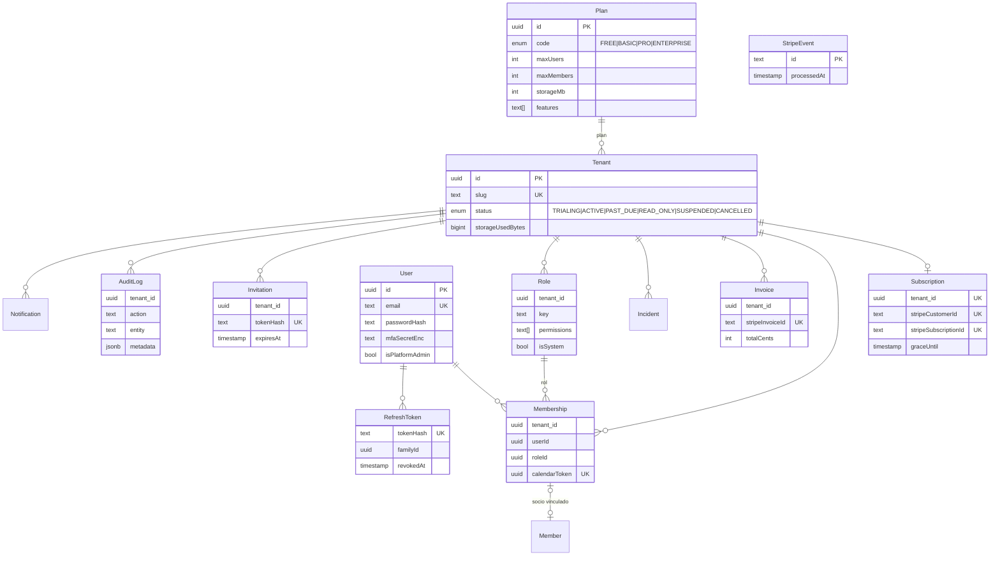
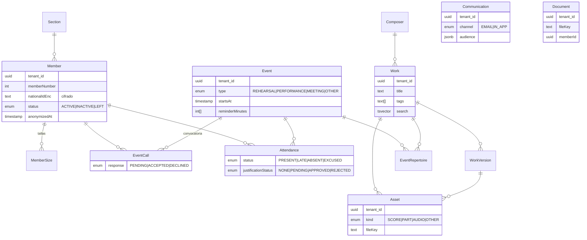
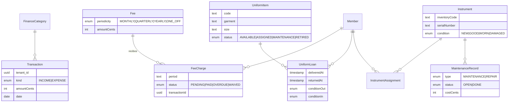
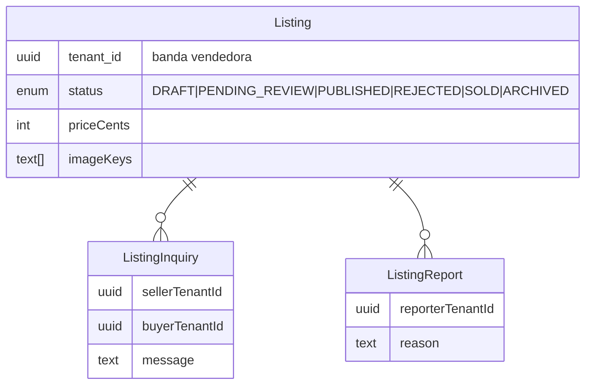
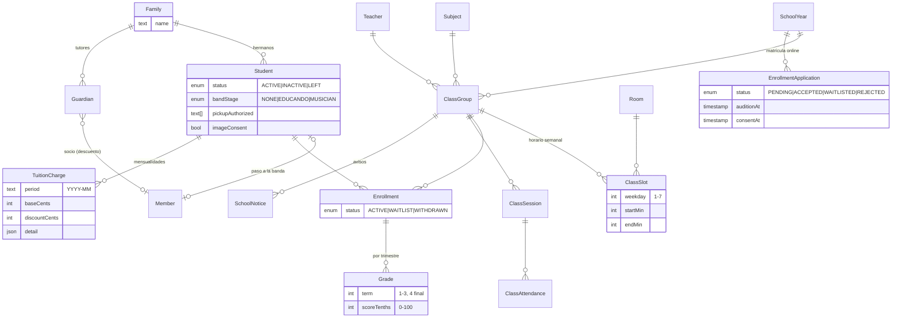
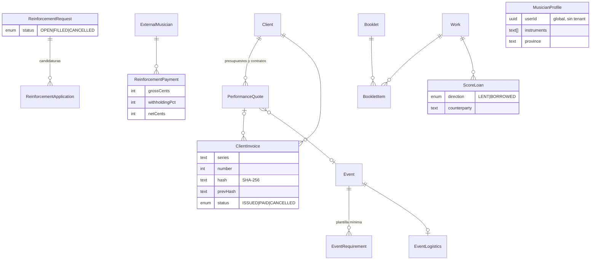
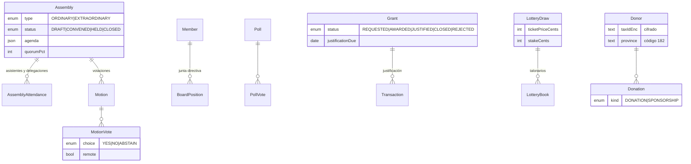
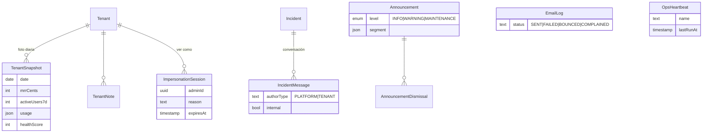

# Modelo de datos

La fuente de verdad del modelo es [`apps/api/prisma/schema.prisma`](../apps/api/prisma/schema.prisma), y se aplica con estas migraciones:

- `0001_init`: tablas, índices y claves foráneas, generadas por Prisma.
- `0002_tenant_isolation`: políticas RLS, triggers `same_tenant`, búsqueda de texto completo, permisos del rol `solfeggio_app` y `audit_logs` en modo *append-only*.
- `0003_integrations`: configuración de integraciones y auditoría de plataforma (sólo rol de sistema).
- `0004_school_and_sector`: escuela de música, actuaciones y facturación, bolsa de refuerzos, libretos y préstamos de partituras, gobierno de la asociación, subvenciones, lotería y donantes. Incluye su RLS, sus triggers `same_tenant`, la inmutabilidad de las facturas emitidas, los add-ons por tenant y la actualización de planes y roles de sistema existentes.
- `0005_governance_fixups`: hasta dos delegaciones de voto por asistente en las asambleas.
- `0006_platform_ops`: panel global (Fase 7): fotos diarias por banda, notas, sesiones de «ver como», conversación y SLA de incidencias, respuestas predefinidas, avisos, registro de correos, latidos de procesos, denuncias de la bolsa de refuerzos, bloqueo de usuarios y cuentas bonificadas.

Convenciones:

- Los identificadores son UUID.
- Todas las tablas de negocio tienen la columna física `tenant_id`. En Prisma se llama `tenantId` y se mapea con `@map`.
- Los importes van en céntimos (`Int`), con la moneda ISO-4217 en minúsculas (`eur`).
- Los nombres de tabla van en `snake_case` y los de columna en `camelCase`; la única excepción es `tenant_id`.

## Diagrama ER

### Plataforma, identidad y facturación

### Secretaría, archivo y ensayos

### Tesorería, mayordomía e instrumentación

### BandMarket

### Escuela de música

Los alumnos no son socios. Se agrupan en familias (los hermanos comparten familia y tutores) y pueden pasar a la banda creando su ficha de socio (`students.memberId`).

### Actuaciones, refuerzos y archivo

### Gobierno y tesorería del sector

### Panel global (plataforma)

Tablas de plataforma: las usa el cliente de sistema desde el panel global y el worker. La banda sólo ve su conversación de soporte (`incident_messages`) sin las notas internas.

## Políticas RLS

`app_current_tenant()` devuelve `NULLIF(current_setting('app.tenant_id', true), '')::uuid`. Si no hay contexto, devuelve `NULL` y la política no deja pasar ninguna fila.

| Tabla(s) | Política | Lectura | Escritura |
|---|---|---|---|
| 70 tablas de negocio (`members`, `works`, `events`, `transactions`, `students`, `client_invoices`, `assemblies`…) | `tenant_isolation` | `tenant_id = app_current_tenant()` | `WITH CHECK` igual |
| `tenants` | `tenant_self` | `id = app_current_tenant()` | El rol de la app sólo puede actualizar `name`, `legalName`, `taxId`, `country`, `timezone` y `locale` (permiso por columna). Estado, plan y cuota los cambia el cliente de sistema |
| `listings` | `listings_read` | `status = 'PUBLISHED'` **o** el anuncio es del tenant | — |
| `listings` | `listings_insert` / `listings_update` / `listings_delete` | — | Sólo el tenant vendedor |
| `listing_inquiries` | `inquiries_read` / `inquiries_insert` | El tenant es el vendedor o el comprador | Inserta sólo el comprador (`buyerTenantId` = el tenant actual) |
| `reinforcement_requests` | `reinforcements_read` (+ insert/update/delete) | `status = 'OPEN'` **o** la necesidad es del tenant | Sólo el tenant que la publica |
| `reinforcement_applications` | `tenant_isolation` | La banda que publicó la necesidad | La crea el músico candidato desde otra banda: la API usa el cliente de sistema con comprobaciones explícitas |
| `incident_messages` | `incident_messages_read` / `incident_messages_insert` | La banda ve sus mensajes **no internos** | La banda sólo inserta mensajes propios (`authorType = 'TENANT'`, no internos); el equipo de plataforma escribe con el cliente de sistema |
| `tenant_snapshots`, `tenant_notes`, `impersonation_sessions`, `canned_replies`, `announcements`, `announcement_dismissals`, `email_logs`, `ops_heartbeats`, `reinforcement_reports` | Sin acceso para la app | — | Sólo el cliente de sistema (panel global y worker) |
| `musician_profiles` | Sin RLS (global por usuario) | — | El rol de la app no tiene acceso; la API filtra siempre por el usuario autenticado |
| `listing_reports` | `reports_rw` | El tenant que denuncia | El tenant que denuncia. La moderación usa el cliente de sistema |
| `plans`, `users`, `refresh_tokens`, `stripe_events` | Sin RLS (tablas globales) | Sólo los servicios de autenticación y de sistema | El rol de la app no tiene ningún acceso a `stripe_events`, `refresh_tokens` ni `_prisma_migrations`, y sólo lectura en `plans` y `users` |

Otras medidas a nivel de base de datos:

- **`same_tenant` (46 triggers):** en `INSERT`/`UPDATE`, cada columna FK listada debe apuntar a una fila del mismo `tenant_id`. Si no, se lanza `ERRCODE 23503`. Afecta a `members.sectionId`, `works.composerId`, `assets.workId` y `assets.versionId`, `event_calls.eventId` y `event_calls.memberId`, `attendance.*`, `fee_charges.*`, `uniform_loans.*`, `instrument_assignments.*`, `memberships.roleId` y `memberships.memberId`, y otras.
- **`audit_logs`:** el rol de la app no tiene `UPDATE` ni `DELETE`, sólo puede añadir filas.
- **`client_invoices`:** el rol de la app no tiene `DELETE`, y el trigger `client_invoices_immutable` impide cambiar los datos fiscales, los importes y la huella de una factura emitida; sólo pueden cambiar el estado de cobro o anulación. Cada factura encadena la huella SHA-256 de la anterior de su serie, como prevé el reglamento VeriFactu (el envío a la AEAT no está implementado).
- **Sólo lectura para la app:** `subscriptions` e `invoices` (las escribe el procesamiento de webhooks con el cliente de sistema). En `incidents` la app puede crear pero no actualizar ni borrar.
- **Búsqueda de socios:** se hace con `unaccent(...) ILIKE unaccent(...)` sobre nombre, apellidos, email e instrumento, de modo que «garcia» encuentra «García».
- **Búsqueda:** el trigger `works_search` mantiene la columna `search`, de tipo `tsvector` en español y sin tildes. Su peso es A para el título, B para compositor y arreglista, C para subtítulo, género y etiquetas, y D para las notas. Cuando cambia el nombre de un compositor, sus obras se reindexan. La columna tiene índices GIN, igual que `tags`.

## Columnas cifradas

| Columna | Contenido | Quién la ve en claro |
|---|---|---|
| `members.nationalIdEnc` | DNI/NIE | Usuarios con `members:sensitive` |
| `guardians.nationalIdEnc` | DNI/NIE del tutor | Usuarios con `members:sensitive` |
| `external_musicians.nationalIdEnc` | NIF de músicos de refuerzo (retenciones) | Usuarios con `members:sensitive` |
| `donors.taxIdEnc` | NIF de donantes (modelo 182) | Usuarios con `members:sensitive`; el resto ve sólo `taxIdHint` |
| `users.mfaSecretEnc` | Semilla TOTP | Nunca se devuelve. Sólo se usa para verificar códigos |

El formato es `v1:<iv>:<tag>:<cifrado>` (base64url), con AES-256-GCM y la clave `DATA_ENCRYPTION_KEY`. Durante una rotación se descifra probando primero la clave actual y después `DATA_ENCRYPTION_KEY_PREVIOUS` (ver [security-gdpr.md](security-gdpr.md)).

Los tokens (de refresco y de invitación) sólo se guardan como hash SHA-256 y las contraseñas con argon2id.
